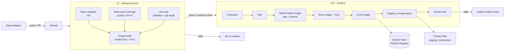

# Documentación técnica – Pipelines CI/CD de SoporteIA API

**Asignatura:** Fundamentos de DevOps – Unidad 3, Actividad 3 (Laboratorio técnico)
**Repositorio:** https://github.com/Cbermudez98/soluzAi-devops

## 1. Contexto y objetivo

SoporteIA ofrece a tiendas en línea un agente de IA de atención al cliente. Hoy despliega de forma manual cada dos semanas (unas tres horas por salida, rollback a mano), sin pruebas ni seguridad automatizadas (ver documento de arquitectura de la Unidad 2).

Este laboratorio implementa la primera fase de la arquitectura propuesta:

- **CI con GitHub Actions** (`.github/workflows/ci.yml`): valida cada cambio con análisis estático, pruebas, seguridad y build de la imagen.
- **CD con Jenkins** (`Jenkinsfile`): construye, escanea, publica y despliega la imagen en Kubernetes, en un entorno agnóstico al proveedor.

La aplicación es una API en FastAPI (patrón Modelo-Vista-Controlador) que simula el servicio de agentes: tiendas, pedidos, chat con detección de intenciones y escalamiento a humano. Su documentación OpenAPI está en `/docs`.

## 2. Flujo general



## 3. Herramientas seleccionadas y justificación

| Herramienta | Fase | Por qué se eligió |
|---|---|---|
| **GitHub** | Código y versiones | Repositorio único con código, pipelines y manifiestos. Cada cambio tiene autor, revisión e historial (trunk-based sobre `main`). |
| **GitHub Actions** | Integración continua | Integrado al repositorio, sin servidor que mantener, se dispara en cada push/PR y muestra el resultado en el propio pull request. Ideal para feedback rápido al desarrollador. |
| **Jenkins** | Entrega continua | Corre dentro de la infraestructura de la empresa, así las credenciales del registro y del clúster no salen de ella. El `Jenkinsfile` versionado convierte en código un proceso que hoy depende de una sola persona. |
| **Python 3.13 + virtualenv** | Build | Entorno de dependencias aislado y reproducible, igual en local, CI y Jenkins. |
| **ruff** | Análisis estático | Linter y formateador en una sola herramienta, muy rápido; detecta errores, imports sin uso y malas prácticas (reglas E, F, I, B, UP). |
| **pytest + pytest-cov** | Pruebas | Pruebas por recurso (tiendas, pedidos, chat, OpenAPI) y unitarias del agente. La cobertura mínima de 90 % evita que entre código sin probar. |
| **Gitleaks** | Seguridad | Busca llaves y secretos en todo el historial. Crítico porque la plataforma maneja llaves de API de las tiendas. |
| **pip-audit** | Seguridad | Revisa las dependencias contra la base de vulnerabilidades de PyPI (OSV). |
| **Docker** | Empaquetado | Imagen inmutable etiquetada con el commit: lo que se prueba es exactamente lo que se despliega. Corre como usuario no root. |
| **Trivy** | Seguridad | Escanea la imagen y detiene el pipeline si hay CVE críticas, antes de publicarla. |
| **Docker Hub / Artifact Registry** | Registro | El registro es un parámetro del `Jenkinsfile`; el mismo pipeline sirve para cualquiera. |
| **Kubernetes + kubectl** | Despliegue | Plataforma objetivo del proyecto. Rolling update sin caída, probes en `/health` y rollback con `rollout undo`. |

## 4. Pipeline de CI – GitHub Actions

Archivo: [`.github/workflows/ci.yml`](../.github/workflows/ci.yml)

**Disparadores:** `push` y `pull_request` a `main`, y ejecución manual (`workflow_dispatch`). Si llegan dos pushes seguidos a la misma rama, se cancela la ejecución anterior (`concurrency`).

| Job | Steps | Qué valida |
|---|---|---|
| **Static analysis** | Checkout → Python → venv + dependencias → `ruff check` → `ruff format --check` | Calidad y estilo del código. Los errores se anotan en el PR. |
| **Tests and coverage** | Checkout → Python → venv + dependencias → `pytest --cov --cov-fail-under=90` → upload test reports | 31 pruebas automáticas; falla si la cobertura baja de 90 %. Publica `coverage.xml` y `junit.xml` como artefactos. |
| **Security** | Checkout (historial completo) → Gitleaks → `pip-audit` | Secretos filtrados y librerías vulnerables. |
| **Image build** | `docker build` → smoke test (`/health`) → Trivy | Solo corre si los tres anteriores pasan. Verifica que la imagen arranca y no tiene CVE críticas. |

Los tres primeros jobs corren en paralelo para dar feedback rápido; el build espera a que todos pasen (`needs`).

## 5. Pipeline de CD – Jenkins

Archivo: [`Jenkinsfile`](../Jenkinsfile) (pipeline declarativo)

| # | Stage | Qué hace | Justificación |
|---|---|---|---|
| 1 | **Checkout** | `checkout scm` y calcula la etiqueta `registro/repo:<commit>` | Garantiza que se despliega exactamente el commit validado. |
| 2 | **Test** | Crea el venv, ejecuta `ruff` y `pytest`, publica resultados JUnit en Jenkins | Red de seguridad: nada se publica sin pruebas, aunque se lance el job a mano. |
| 3 | **Build Docker image** | `docker build` con tag del commit y `latest` | Imagen inmutable y trazable (label `org.opencontainers.image.revision`). |
| 4 | **Scan image (Trivy)** | Falla si hay CVE críticas | Seguridad antes de publicar (*shift-left*). |
| 5 | **Push image** | `docker login` con la credencial `registry-credentials` y `docker push` | Las credenciales viven en Jenkins, no en el código. |
| 6 | **Deploy to Kubernetes** | Crea el namespace si no existe, aplica `k8s/`, actualiza la imagen y espera el rollout | Despliegue declarativo y repetible; solo en `main`. |
| 7 | **Smoke test** | Pod temporal que llama a `http://soporteia-api/health` | Confirma que la nueva versión responde dentro del clúster. |

**Post-acciones:** si el pipeline falla, ejecuta `kubectl rollout undo` (rollback automático); siempre cierra sesión en el registro, borra las imágenes locales y limpia el workspace.

**Parámetros (entorno agnóstico):**

| Parámetro | Por defecto | Uso |
|---|---|---|
| `REGISTRY` | `docker.io` | Cualquier registro: Docker Hub, Artifact Registry, ECR, ACR. |
| `IMAGE_REPO` | `cbermudez98/soporteia-api` | Repositorio de la imagen. |
| `DEPLOY_ENV` | `staging` | Namespace destino (`staging` o `production`). |
| `SKIP_DEPLOY` | `false` | Solo construir y publicar. |

**Configuración en Jenkins:**

1. Plugins: *Pipeline*, *Git*, *Credentials Binding*, *JUnit*, *Timestamper*, *Workspace Cleanup*.
2. Agente con `git`, `docker`, `python3`, `trivy` y `kubectl`.
3. Credenciales: `registry-credentials` (usuario/contraseña o token) y `kubeconfig` (*Secret file*).
4. Crear un job **Multibranch Pipeline** apuntando al repositorio (la condición `branch 'main'` requiere multibranch).

**Manifiestos de Kubernetes** ([`k8s/`](../k8s)): `Deployment` con rolling update sin indisponibilidad (`maxUnavailable: 0`), readiness/liveness probes en `/health`, límites de CPU/memoria, usuario no root y sistema de archivos de solo lectura; `Service` `ClusterIP` en el puerto 80.

## 6. Despliegue adicional en GCP (GitHub Actions)

Además de los pipelines pedidos, [`.github/workflows/deploy.yml`](../.github/workflows/deploy.yml) despliega la API en **Cloud Run** cuando el CI pasa en `main`, autenticándose con Workload Identity Federation (sin llaves JSON). Sirve como entorno público para las pruebas de carga con k6 de la siguiente fase. La configuración está en el [README](../README.md#configuración-de-gcp-una-sola-vez).

## 7. Cómo ejecutar localmente

```bash
python -m venv .venv
.venv\Scripts\activate          # Windows
source .venv/bin/activate       # Linux / macOS
pip install -r requirements-dev.txt

ruff check . && ruff format --check .
pytest --cov=app
uvicorn app.main:app --port 8080   # http://localhost:8080/docs
```

## 8. Evidencias

> Guardar las capturas en `docs/evidencias/` con estos nombres para que se muestren aquí.

### 8.1 GitHub Actions – CI ejecutado automáticamente por un push


### 8.2 GitHub Actions – detalle de los jobs (análisis, pruebas, seguridad, build)


### 8.3 GitHub Actions – pruebas y cobertura


### 8.4 Jenkins – vista de stages del pipeline


### 8.5 Jenkins – consola de la ejecución


### 8.6 API desplegada – Swagger UI


## 9. Referencias

- Kim, G., Humble, J., Debois, P., Willis, J. y Forsgren, N. (2022). *Manual de DevOps: Transformación exitosa de equipos, herramientas e infraestructura* (2.ª ed.). dpunkt.
- Lwakatare, L. E. et al. (2016). Relationship of DevOps to Agile, Lean and Continuous Deployment: A Multivocal Literature Review Study. En *Product-Focused Software Process Improvement* (pp. 399–415). Springer. https://doi.org/10.1007/978-3-319-49094-6_27
- Turnbull, J. (2014). *The Docker Book: Containerization is the new virtualization*. Turnbull Press.
